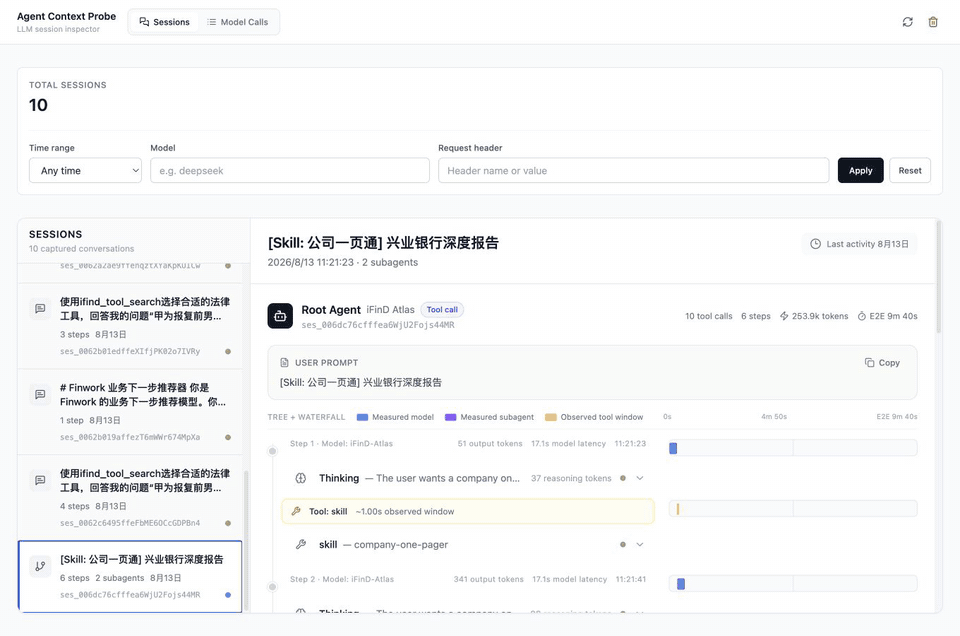

# Agent Context Probe



Agent Context Probe is a local proxy and Dashboard for inspecting Anthropic
Messages, OpenAI Chat Completions, and OpenAI Responses traffic. The production
build is one Go executable: the React Dashboard is compiled as a SPA and
embedded in the binary.

The default command is:

```bash
agent-context-probe start
```

The proxy, management API, health check, and Dashboard share
`http://127.0.0.1:3001`.

## Features

- Transparent Anthropic Messages, OpenAI Chat Completions, and OpenAI Responses proxying
- Streaming and non-streaming response capture
- First generated stream content timestamp and proxy-observed TTFT in request history
- SQLite request history with model, time, and header filters
- Session and parent/subagent trace views
- Normalized messages, reasoning, tool calls, tool results, token usage, and latency
- Optional Claude Code subagent routing to different upstream models
- One executable with an embedded Dashboard; Node.js is not required at runtime
- Local-only listening by default
- Sensitive request and response headers redacted before SQLite persistence
- Explicit token authentication for non-loopback listening

For streaming model responses, the stored response includes `firstTokenAt`
(RFC 3339 timestamp) and `ttftMs` (milliseconds from the proxy handler's request
start to the first completed SSE data line with generated text, reasoning, or
tool-call content). Metadata, usage, empty deltas, and terminal events do not
count. These fields are absent when no generated content is observed, including
non-streaming responses. The timing reflects arrival at this proxy, not delivery
to the client.

## Build from source

Building requires Go 1.21 or later and Node.js 20 or later. The resulting
executable does not require Go, Node.js, npm, or a separate SQLite library.

### macOS and Linux

```bash
git clone https://github.com/2proveit/agent-context-probe.git
cd agent-context-probe
make install
make build
./bin/agent-context-probe start
```

`./run.sh` performs the build and start sequence as a convenience.

### Windows

Run in PowerShell:

```powershell
git clone https://github.com/2proveit/agent-context-probe.git
Set-Location agent-context-probe
powershell -NoProfile -ExecutionPolicy Bypass -File .\run.ps1
```

The script builds `bin\agent-context-probe.exe` and starts the single process.

## Install a Release

Release archives contain the executable, configuration example, README,
LICENSE, and install/uninstall scripts. On macOS and Linux:

```bash
./scripts/install.sh --version 0.1.0-beta.1
export PATH="$HOME/.local/bin:$PATH" # if the installer reports it is missing
agent-context-probe version
```

On Windows:

```powershell
.\scripts\install.ps1 -Version 0.1.0-beta.1
agent-context-probe.exe version
```

Running the installer again atomically replaces the executable and preserves
configuration, request history, and backups. The uninstall scripts remove only
the executable; user data is retained. The Windows installer adds its install
directory to the user PATH and the Windows uninstaller removes that exact entry.

## CLI

```text
agent-context-probe start [--config FILE] [--data-dir DIR] [--host HOST] [--port PORT]
agent-context-probe doctor [--config FILE] [--data-dir DIR] [--host HOST] [--port PORT]
agent-context-probe version
```

Running the executable without a subcommand remains equivalent to `start`.

`doctor` validates the resolved configuration, embedded Dashboard, data
directory, database schema, and listen address without contacting an upstream
provider or modifying files. Run it while the service is stopped so it can test
the configured port.

### Standard user directories

| System  | Configuration                                                   | Request database and backups                            |
| ------- | --------------------------------------------------------------- | ------------------------------------------------------- |
| macOS   | `~/Library/Application Support/Agent Context Probe/config.yaml` | `~/Library/Application Support/Agent Context Probe/`    |
| Linux   | `${XDG_CONFIG_HOME:-~/.config}/agent-context-probe/config.yaml` | `${XDG_DATA_HOME:-~/.local/share}/agent-context-probe/` |
| Windows | `%APPDATA%\Agent Context Probe\config.yaml`                     | `%LOCALAPPDATA%\Agent Context Probe\`                   |

No configuration file is created automatically. The data directory is created
on first start. The application no longer discovers `.env`, parent-directory
configuration files, or a current-directory `requests.db`; source checkouts can
keep the legacy layout by using `./run.sh`, `run.ps1`, `--config`, `--data-dir`,
or `DB_PATH` explicitly.

## Use the proxy

Start Agent Context Probe, then open the Dashboard:

```text
http://127.0.0.1:3001/
```

For Claude Code or another Anthropic-compatible client:

```bash
export ANTHROPIC_BASE_URL=http://127.0.0.1:3001
claude
```

PowerShell equivalent:

```powershell
$env:ANTHROPIC_BASE_URL = "http://127.0.0.1:3001"
claude
```

For an OpenAI-compatible client, use this local API prefix:

```text
http://127.0.0.1:3001/v1
```

Available endpoints:

- `POST /v1/messages`
- `POST /v1/chat/completions`
- `POST /v1/responses`
- `GET /v1/models`: requests with an `anthropic-version` or `x-api-key` header
  forward to `providers.anthropic.base_url` + `/v1/models`, preserving `x-api-key`
  and filling in a missing `anthropic-version` from configuration. Other requests
  (including Bearer-only requests) forward to `providers.openai.base_url` + `/models`.
  If the selected provider has no custom base URL and the other provider does,
  the request falls back to the other provider. Empty base URLs and the built-in
  defaults (ignoring surrounding whitespace and trailing slashes) count as
  unconfigured; when both or neither are configured, header routing is retained.
  Both branches preserve the upstream status and body and capture the request/response
  for the dashboard. Upstream connection failures return 502.
- `GET /health`
- `GET /api/requests`
- `DELETE /api/requests`
- `GET /api/sessions`
- `GET /api/ui-config`

The removed `/api/grade-prompt` frontend route had no Go implementation and is
not part of the supported API.

## Security model

The default host is `127.0.0.1`. Cross-origin access is not enabled: the
Dashboard calls the Go API on the same origin.

The proxy forwards the original client credentials to the selected upstream,
subject to existing provider rules. A configured `OPENAI_API_KEY` replaces the
incoming OpenAI `Authorization` value for the upstream request. The stored copy
is separate: values for headers such as `Authorization`, `Proxy-Authorization`,
`Cookie`, `Set-Cookie`, and `X-Api-Key` are replaced with `[REDACTED]` before
being written to SQLite or returned by the management API. On startup, existing
rows are also migrated to remove those stored header values.

Selected configuration files, SQLite databases, and backups use mode `0600` on
Unix-like systems. Newly created data and backup directories use mode `0700`.

### Non-loopback listening

Listening on `0.0.0.0`, `::`, or a LAN address requires an access token of at
least 16 characters. Configure it through `ACP_ACCESS_TOKEN` or
`server.access_token`:

```bash
ACP_HOST=0.0.0.0 \
ACP_ACCESS_TOKEN='replace-with-a-long-random-value' \
agent-context-probe start
```

Remote API clients must send the token in
`X-Agent-Context-Probe-Token`. This control header is removed before proxying
and is never sent to an upstream provider. Browser users are redirected to
`/auth`; successful login creates an HttpOnly, SameSite=Strict session cookie.
Use a TLS reverse proxy when traffic crosses an untrusted network.

## Configuration

Copy `config.yaml.example` to `config.yaml` when file-based configuration is
needed:

```yaml
server:
  host: "127.0.0.1"
  port: 3001
  timeouts:
    read: 15m
    write: 15m
    idle: 15m

providers:
  anthropic:
    base_url: "https://api.anthropic.com"
    version: "2023-06-01"
    max_retries: 3
  openai:
    base_url: "https://api.openai.com/v1"
    # api_key: "prefer OPENAI_API_KEY"

storage:
  # Omit db_path to use the operating system standard data directory.
  # db_path: "/custom/path/requests.db"
  # backup_dir: "/custom/path/backups"
  max_capture_bytes: 10485760

web:
  show_raw_stream_events: false
  raw_request_max_display_chars: 0
  raw_response_max_display_chars: 0
```

Configuration value priority is command-line override, environment variable,
configuration file, then built-in default. Configuration file selection is
`--config`, then `ACP_CONFIG`, then the standard configuration path. Database
selection is `--data-dir`, then `DB_PATH`, then `ACP_DATA_DIR`, then
`storage.db_path`, then the standard data directory. Relative paths in YAML are
resolved from the selected configuration file directory.

Environment variables:

| Variable                | Purpose                                     |
| ----------------------- | ------------------------------------------- |
| `ACP_CONFIG`            | Explicit configuration file path            |
| `ACP_DATA_DIR`          | Data directory used when `DB_PATH` is unset |
| `ACP_HOST`              | Listen host; defaults to `127.0.0.1`        |
| `ACP_PORT`              | Listen port; defaults to `3001`             |
| `PORT`                  | Backward-compatible port alias              |
| `ACP_ACCESS_TOKEN`      | Required for non-loopback listening         |
| `READ_TIMEOUT`          | Go duration such as `30s` or `15m`          |
| `WRITE_TIMEOUT`         | Go duration                                 |
| `IDLE_TIMEOUT`          | Go duration                                 |
| `ANTHROPIC_FORWARD_URL` | Anthropic upstream base URL                 |
| `ANTHROPIC_VERSION`     | Anthropic API version                       |
| `ANTHROPIC_MAX_RETRIES` | Anthropic retry count                       |
| `OPENAI_BASE_URL`       | OpenAI-compatible upstream API prefix       |
| `OPENAI_API_KEY`        | Optional upstream OpenAI key                |
| `DB_PATH`               | SQLite database path                        |

`storage.max_capture_bytes` limits retained OpenAI request and response bytes;
it does not truncate the proxied exchange. The raw display limits affect only
Dashboard rendering and not the stored value.

### Database schema upgrades

SQLite schema versions are recorded with `PRAGMA user_version`. A database
whose schema is newer than the executable is rejected to prevent downgrade
writes. When an existing database requires an upgrade, Agent Context Probe:

1. removes persisted sensitive header values;
2. creates a consistent SQLite backup under the configured backup directory;
3. validates the backup with `PRAGMA quick_check`;
4. applies all pending migrations in one transaction.

Backup files are never deleted automatically. `doctor` reports the current and
target schema without performing the migration.

## Model mappings

Set `model_mappings` in `config.yaml` to replace exact incoming model names:

```yaml
model_mappings:
  claude-sonnet: deepseek-v4-flash
  gpt-4o: custom-openai-model
```

Mappings apply to Anthropic Messages, OpenAI Chat Completions, and OpenAI
Responses requests. The proxy changes only the upstream request's `model`
value; a model mapping never changes the selected provider. Ordinary Anthropic
requests use `providers.anthropic.base_url`; OpenAI requests use
`providers.openai.base_url`. Existing subagent routing may select a different
provider before the model mapping is applied. Mappings are exact and applied
once. Successful JSON and streaming responses report the client's original
model name, while request records retain both `originalModel` and
`routedModel`.

## Optional subagent routing

```yaml
subagents:
  enable: true
  mappings:
    code-reviewer: "gpt-4o"
    deep-reasoning: "o3"
```

Mappings are applied only when the matching Claude Code subagent definition is
available. Unmapped models continue through the normal provider selection.

## Docker

The runtime image contains one process and one exposed port. It has no Node.js
runtime or `node_modules`.

```bash
docker build -t agent-context-probe .
docker run --rm \
  -p 3001:3001 \
  -e ACP_ACCESS_TOKEN='replace-with-a-long-random-value' \
  -v ./data:/app/data \
  agent-context-probe
```

The container listens on `0.0.0.0`, so the access token is mandatory. Open
`http://127.0.0.1:3001/` and enter the same token. API clients must send the
control header described above. SQLite data is stored at
`/app/data/requests.db` by default.

## Development

```bash
make install
make build       # SPA build, asset synchronization, then Go build
make dev         # build and start the single process
make run-proxy   # build the SPA and run the Go process through go run
make run-web     # optional Vite development server with /api proxying
make clean
make db-reset
```

Release validation:

```bash
goreleaser check
goreleaser release --snapshot --clean --skip=publish
```

Pushing a `v*` tag triggers `.github/workflows/release.yml`. The workflow builds
the tag artifacts once without publishing, tests those exact archives through
install/start/upgrade/uninstall without Go, Node.js, or npm in `PATH`, then
uploads the same files to the GitHub Release and publishes the `linux/amd64`
plus `linux/arm64` GHCR image. Archives include SHA-256 checksums and SPDX JSON
SBOMs; GitHub generates provenance attestations for release artifacts and the
container image.

Validation commands:

```bash
cd proxy && go test ./...
cd ../web && npm run typecheck && npm test
cd ../web && npm run lint && npm run build
```

Type checking, tests, lint, and the production SPA build are separate checks;
run them independently when diagnosing an existing codebase violation.

## Project structure

```text
agent-context-probe/
├── proxy/
│   ├── cmd/agent-context-probe/  # CLI entry point
│   └── internal/
│       ├── app/                  # application composition and lifecycle
│       ├── buildinfo/            # injected version, commit, and build time
│       ├── capture/              # persistence redaction policy
│       ├── handler/              # protocol and management handlers
│       └── webui/                # embedded SPA and fallback handler
├── web/                          # React/Vite SPA source
├── Dockerfile                    # single-process runtime image
├── Makefile
├── run.ps1
└── run.sh
```

## Acknowledgements

Agent Context Probe was originally derived from
[seifghazi/claude-code-proxy](https://github.com/seifghazi/claude-code-proxy)
and has since evolved into an independently maintained project.

We thank Seif Ghazi and the original contributors for their work. The original
project and Agent Context Probe are distributed under the MIT License. See
[LICENSE](LICENSE) for the applicable copyright and license notices.

## License

MIT License. See [LICENSE](LICENSE).

## Downstream response fault injection

`response_corruption` simulates unstable model responses **received by the
harness**. Requests still go to the configured provider unchanged. After routing,
provider conversion, and model-alias restoration, the proxy can replace a selected
HTTP 200 response with a synthetic bad response in the client's own protocol.

```text
Harness -- original request --> Proxy --> Model provider
Harness <-- faulty response -- Proxy <-- provider response
```

The feature defaults to disabled. Copy the section from `config.yaml.example`
and restart the proxy. To exercise one failure deterministically:

```yaml
response_corruption:
  enabled: true
  probability: 1
  seed: 42
  modes: [empty_stop]
```

| Mode                     | What the downstream harness receives                                                                                                                                                    |
| ------------------------ | --------------------------------------------------------------------------------------------------------------------------------------------------------------------------------------- |
| `empty_stop`             | A complete reasoning-only response with no visible text or tool calls. Chat ends with `stop`, Messages with `end_turn`, and Responses with `completed` containing only reasoning.       |
| `repetition`             | A complete text response with `果树。` repeated 1,400 times and a replacement character.                                                                                                |
| `pseudo_tags`            | A complete text response containing fake tool-return and system-warning tags.                                                                                                           |
| `invalid_tool_arguments` | A call to the first declared request tool with deliberately invalid argument JSON. For non-streaming Messages, `tool_use.input` is deliberately a string instead of an object.          |
| `xml_tool_name`          | A tool call whose name contains XML-style function/parameter text instead of a registered tool name; arguments remain valid `{}`.                                                       |
| `truncate_stream`        | Only a prefix of the first SSE application chunk, followed by EOF without the protocol's terminal event. This is incomplete SSE inside a normally ended HTTP response, not a TCP reset. |

`xml_tool_name` reproduces a different tool-protocol failure observed in
`req_c3187a9d53b84415b06b29e885172a22`: the tool name becomes
`<function=FIRST_TOOL>\n<parameter=name>\nsynthetic-fault\n</parameter>\n</function>`,
while arguments stay valid empty JSON `{}`. It emits a normal tool-call finish
and complete stream, so a harness must validate the registered tool name even
when argument decoding succeeds. It is available for all three protocols, both
JSON and SSE. No tool is executed by the proxy.

For Chat Completions SSE this mode follows the captured data-frame order:
synthetic reasoning deltas, whitespace content, a tool frame with the entire
XML name and empty arguments, a continuation containing only `{}` arguments
(without repeating the call ID/name), `tool_calls` finish, usage, and `[DONE]`.
Every synthetic SSE event is written and flushed separately. HTTP/TCP can still
coalesce writes. Historical reasoning text, token counts, timestamps, delays,
and the original multi-call count are not replayed; the synthetic profile emits
one call using the first declared tool and reports zero usage.

The first three modes are based on the observed shapes of repetition,
pseudo-tag contamination, and reasoning-only empty-stop badcases. They simulate
those failures without relying on the provider to reproduce them. Mode selection
happens after the provider has returned HTTP 200. Upstream 4xx/5xx responses and
connection failures remain unchanged; health, Dashboard, and model-list endpoints
are excluded.

Omit `modes` to select randomly among all six. `truncate_stream` is excluded for
non-SSE responses. Tool-call fault modes (`invalid_tool_arguments`,
`xml_tool_name`) are excluded when no tool is specified. Probability is applied
to the remaining eligible responses; if none of the requested modes applies, that response passes through without a fault marker.
Duplicate mode names weight selection. `probability: 0` also disables injection.
The synchronized generator repeats the same sequence for the same seed, eligible
response order, streaming format, and tool availability. Concurrent completion
order can change which request receives a particular fault.

`truncate_after_bytes` defaults to 256 (also when set to zero). The truncation
point is the smaller of that limit and half of the first write's bytes, so chunk
boundaries can affect the actual prefix. Invalid probabilities, unknown modes,
and negative limits fail startup even when injection is disabled.

The injector is the final response layer so internal protocol conversion cannot
repair the fault before it reaches the harness. When the first provider bytes are
available, the selected synthetic response is flushed and further provider work
is cancelled through a private context. Subsequent handler output is suppressed.
For non-streaming protocols the existing handler may have already buffered the
provider response before injection. Synthetic usage is zero, not measured provider
usage. Credentials, model-provider URLs, and outgoing request bodies are untouched.

The client receives `X-Agent-Context-Probe-Corruption` (mode) and
`X-Agent-Context-Probe-Corruption-Id` (fault ID). Logs record these identifiers,
the client protocol, and injected byte count without prompt or credential text.
The captured response headers retain those markers plus
`X-Agent-Context-Probe-Corruption-Capture: upstream-before-injection`. SQLite
continues to store provider-side bytes seen before injection; after cancellation
that capture may be incomplete and have a stream error. It is **not** a recording
of the synthetic bytes received by the client. Capture the harness-side raw
response when assessing recovery.

Local checks exercise three protocols, both JSON and SSE, byte-for-byte unchanged
upstream requests, downstream fault contents, cancellation, metadata capture,
seed replay, concurrency, and an illustrative bounded retry after an empty stop:

```bash
cd proxy
go test -race ./internal/app ./internal/config ./internal/middleware ./internal/handler -run 'TestResponseCorruption|TestInjectedStream|TestDownstreamConsumer'
```

These tests establish the proxy's fault-delivery behavior. The retry consumer is
a small test client, not Lumi or OpenCode acceptance. To assess a real harness,
point its model endpoint at this proxy, start with one mode and probability 1,
and inspect the harness's validation, retries, tool dispatch, termination, and
final delivery. Test mixed healthy/faulty responses afterward with a probability
below 1. Restore `enabled: false` and restart when the experiment is finished.

The earlier experimental `request_corruption` implementation mutated upstream
requests and did not test this failure direction. It has been replaced; use the
`response_corruption` section above. Earlier request-pollution replay artifacts
are historical evidence of that superseded experiment, not harness-stability
results.
